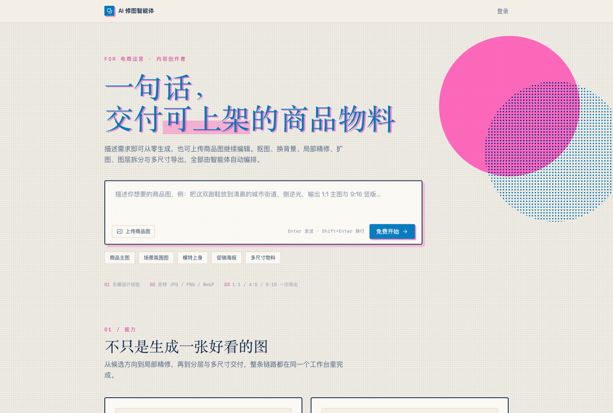
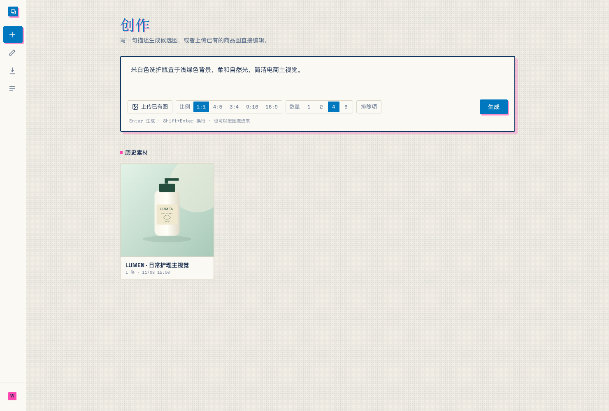
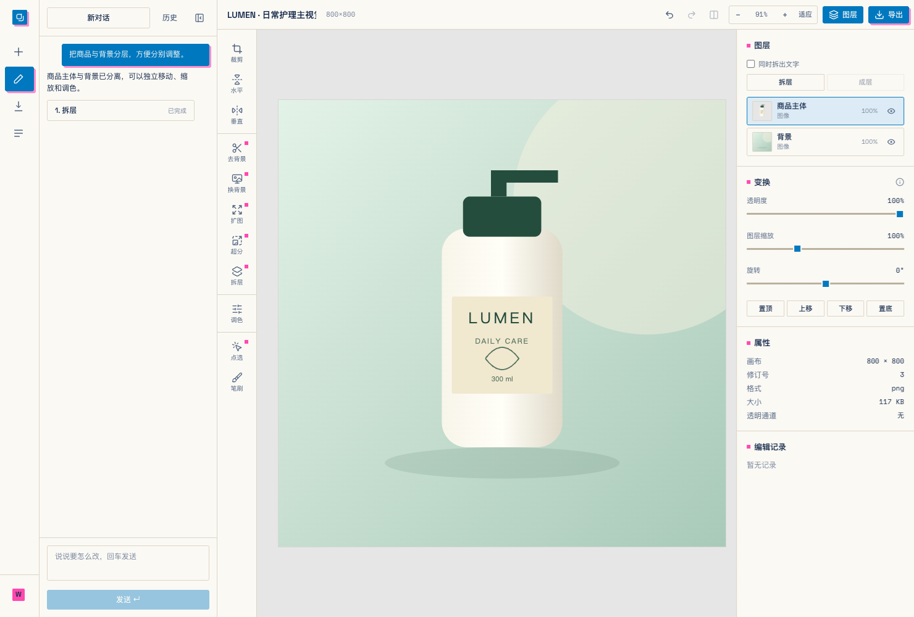
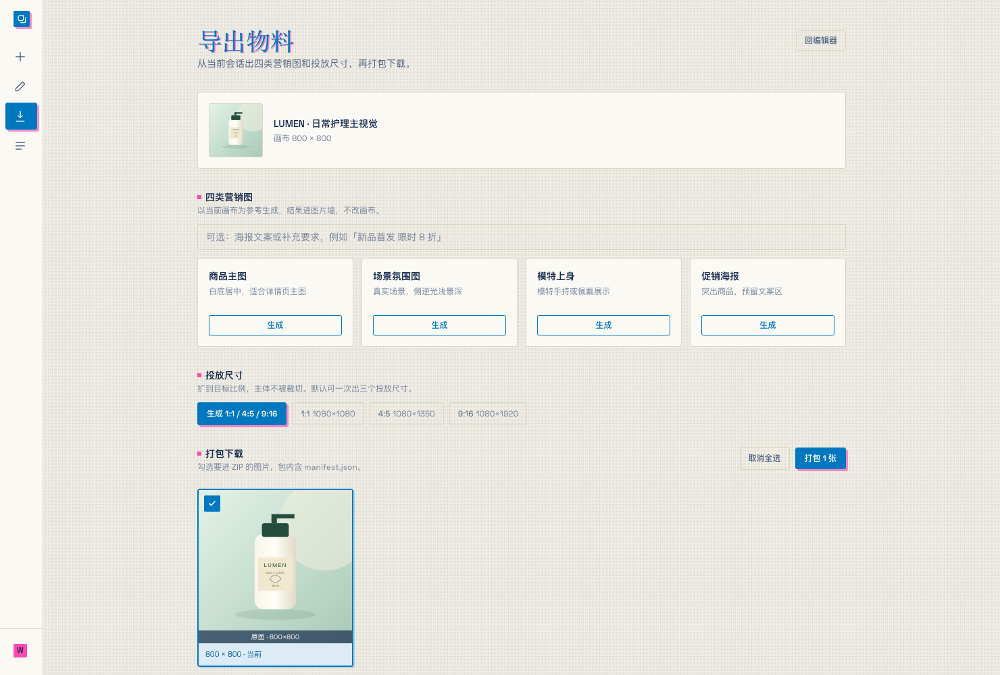
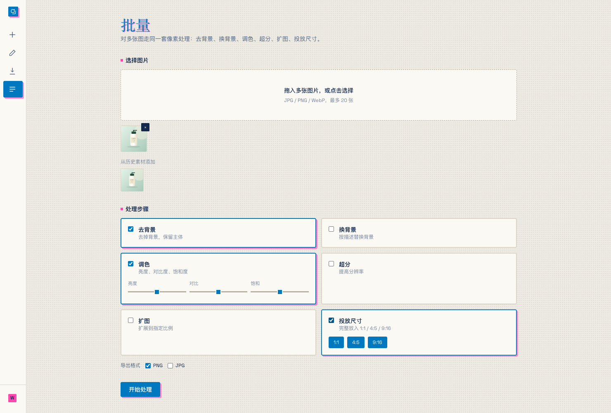
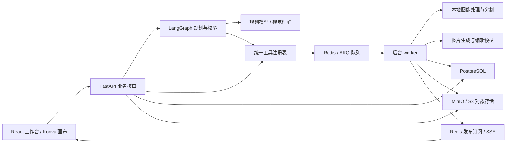

# picture-editor

**用对话完成图片创作，把商品素材整理成可交付的视觉物料。**

picture-editor 是面向电商运营与内容创作者的 AI 图片工作台。输入描述生成候选图，或上传已有商品图进入编辑器；在同一个会话中完成抠图、换背景、局部修改、图层调整、营销图生成和多尺寸导出。

[界面预览](#界面预览) · [功能](#功能) · [架构](#架构) · [运行配置](#运行配置)



## 功能

| 能力 | 可以完成的工作 |
| --- | --- |
| 图片生成 | 输入画面描述，选择比例与数量，生成候选图后进入编辑 |
| 对话式修图 | 结合用户指令、图层摘要和当前画布预览规划操作；DeepSeek 路径接入视觉输入 |
| 图层画布 | 平移、缩放、旋转、翻转、调整透明度与层级，管理图层显隐和文字内容 |
| 主体与背景 | 本地去背景，将主体、背景或选中的物体分离成独立图层 |
| 区域编辑 | 通过点选或笔刷确定区域，执行局部消除、替换、改色或材质调整 |
| 色彩与清晰度 | 调整明暗、对比度、冷暖、饱和度、锐化等参数，或调用图像模型提高分辨率 |
| 画幅扩展 | 按描述延伸画面，适配新的构图比例 |
| 电商营销图 | 以当前画布为基础生成商品主图、场景氛围图、模特展示图和促销海报 |
| 批量处理 | 最多选择 20 张图片，组合去背景、换背景、调色、超分、扩图与尺寸适配 |
| 物料交付 | 输出 1:1、4:5、9:16 等比例，将选中的图片和清单打包为 ZIP |

界面按钮与智能体调用同一套工具。编辑结果、会话图片墙、图层文档和历史记录统一保存，支持撤销、重做和继续编辑。再次打开同一素材会复用已有会话。

## 界面预览

当前界面采用蓝粉双色套印、纸张底色与网点纹理。工作台将创作、精修、批量和导出分别组织，编辑器内的对话栏与属性面板可以收起，为画布留出空间。

以下截图来自当前前端界面，使用示例商品素材与展示数据；图中的商品插画不代表模型生成效果。

### 创作与素材管理

描述画面、选择比例和候选数量，也可以上传已有图片直接编辑。历史素材按会话收拢，候选图与后续产物保留在图片墙中。



### 对话与图层编辑

左侧描述修改要求，中间操作画布，右侧管理图层、变换和属性。支持主体与背景分离、局部选区、前后对比，以及收起面板后的大画布操作。



### 营销图与多尺寸交付

从当前会话生成四类营销图，保留原画布；选择投放比例，将主体完整放入目标画幅，再统一选择和打包产物。



### 批量流水线

为多张图片配置同一套处理步骤，查看批次进度与逐项结果，并按所选格式导出。



## 从创作到交付

1. **开始创作**：描述需要的画面，或上传已有商品图。
2. **进入会话**：选定候选图，在图片墙中保留其他方向。
3. **精修画面**：使用对话或工具栏调整图层、颜色、背景与局部内容。
4. **扩展物料**：生成营销图，或对多张素材应用同一套处理流程。
5. **导出交付**：选择尺寸与产物，打包下载。

## 架构

前端使用 React、TypeScript 与 Konva 图层画布。后端由 FastAPI 提供业务接口，耗时操作通过 ARQ 异步任务队列交给独立 worker 进程执行；SSE（服务器发送事件）将任务进度推送回浏览器。



| 层级 | 实现 |
| --- | --- |
| 前端 | React 19、TypeScript、Vite、Tailwind CSS、React Query、Zustand、react-konva |
| 后端 | Python 3.13、FastAPI、Pydantic、SQLAlchemy、Alembic |
| 智能体 | LangChain 绑定工具签名，LangGraph 编排规划与校验 |
| 异步执行 | ARQ、Redis、独立 worker、任务进度推送 |
| 图像处理 | Pillow、OpenCV、ONNX Runtime、U²-Net、SAM、RapidOCR |
| 数据与文件 | PostgreSQL 保存业务与图层文档；MinIO 或兼容 S3 的存储保存图片与遮罩 |
| 部署 | Docker 多阶段构建、Docker Compose、前后端同源托管 |

### 智能体执行

- 规划输入包含用户要求、图层与选区摘要；DeepSeek 规划路径还会附上当前图层合成的画布预览。
- 模型输出工具名称与参数，后端校验工具是否存在、参数是否合法、依赖是否有效。
- 每轮计划最多 8 步。多步计划支持确认、取消和失败步骤重试，执行状态保存到数据库。
- 图像、图层与选区分别管理：工具可以只作用于某个图层，或进一步限定到该层内的选区。
- DeepSeek 负责理解画面和规划操作；实际图片生成、重绘由图片模型执行，本地操作由对应图像处理模块完成。

### 图片与会话

图片、透明图层和遮罩以独立对象保存，数据库记录素材归属、尺寸、格式和存储位置。浏览器通过短时签名地址读取图片，不接触对象存储密钥。

图层文档保存到 PostgreSQL 的 JSONB 字段中。任务队列主要传递执行记录编号，worker 按需读取图片，完成后保存产物、更新编辑状态并发布进度。重连进度流时会先返回当前状态快照。

## 运行配置

### 环境

- Python 3.13 或更新版本、uv。
- Node.js 22.12 或更新版本、npm。
- PostgreSQL 17、Redis 7，以及 MinIO 或兼容 S3 的对象存储。
- 本地视觉能力对应的模型权重；图片生成与视觉规划对应的服务凭据。

### 应用配置

```bash
git clone https://github.com/ReRuol/picture-editor.git
cd picture-editor
cp .env.example .env
```

`.env` 位于仓库根目录。按部署环境填写数据库、Redis、对象存储和模型配置。图片模型与规划模型独立选择，例如：

```dotenv
IMAGE_PROVIDER=volcengine
VOLCENGINE_API_KEY=your-image-provider-key
VOLCENGINE_IMAGE_MODEL=your-model-or-endpoint-id

PLANNER_PROVIDER=deepseek
DEEPSEEK_API_KEY=your-planner-key
DEEPSEEK_PLANNER_MODEL=deepseek-flash
```

| 配置 | 用途 |
| --- | --- |
| `IMAGE_PROVIDER` | 图片生成与编辑，支持 `volcengine`、`dashscope` |
| `PLANNER_PROVIDER` | 指令规划，支持 `deepseek`、`volcengine`、`dashscope` |
| `DATABASE_URL`、`REDIS_URL` | 业务数据库与任务队列连接 |
| `S3_ENDPOINT`、`S3_BUCKET` | 对象存储内部地址与存储桶 |
| `S3_PUBLIC_ENDPOINT` | 浏览器能够访问的对象存储入口 |
| `JWT_SECRET` | 登录会话签名密钥 |
| `REGISTRATION_ENABLED`、`ALLOWED_USERNAME` | 后端注册与账号访问策略 |
| `MATTING_PROVIDER`、`OCR_PROVIDER` | 本地抠图与文字识别策略 |

视觉规划使用支持图片输入的模型；其他规划服务需按所选模型能力配置。生成和编辑的费用取决于所选模型服务与调用配置。

登录入口使用邮箱，当前界面不提供公开注册入口。部署前需预置可用账号；`ALLOWED_USERNAME` 限定已有账号，不会自动创建账号。请使用自己的账号与凭据，仓库不提供公共登录密码。

### 本地视觉模型

去背景使用本地 U²-Net 权重，通过 ONNX Runtime 在 CPU 上推理；模型会话复用，并限制推理线程和内存分配策略。worker 启动时检查权重文件，用户操作期间不会临时下载抠图权重。

默认可将 `u2net.onnx` 放在 `~/.u2net/`；也可以通过 `U2NET_HOME` 指定模型目录，在其根目录放置该文件。点选分割使用 SAM，文字识别使用 RapidOCR，启用相应能力时需准备对应依赖与权重。

### 启动服务

先准备好 `.env` 中配置的 PostgreSQL、Redis 和对象存储，再启动应用。仓库的 `docker-compose.yml` 包含基础服务与应用部署配置，镜像版本、端口和数据卷需与实际环境匹配。

```bash
cd backend
uv sync --all-extras --no-dev
uv run alembic upgrade head
uv run uvicorn app.main:app --host 0.0.0.0 --port 7302
```

在另一个终端启动后台进程：

```bash
cd backend
uv run arq app.worker.WorkerSettings
```

启动前端：

```bash
cd frontend
npm ci
npm run dev
```

访问 `http://localhost:7301`。后端接口文档位于 `http://localhost:7302/api/docs`，健康状态位于 `/api/health`。

### 容器部署

`Dockerfile` 会编译前端并将产物放入后端镜像，由应用同源提供页面和接口。`docker-compose.yml` 的 `deploy` 配置组包含应用与 worker，两者使用同一份模型、数据库及对象存储配置。

部署时为数据库、Redis、对象存储和本地模型设置持久化数据卷，并配置外部访问域名、HTTPS、随机会话签名密钥和账号策略。容器内的对象存储地址与浏览器的公开访问地址通过不同配置项分别指定。

## 项目结构

```text
picture-editor/
├── frontend/src/
│   ├── pages/             创作、编辑、批量、导出页面
│   ├── components/        画布、图层面板、对话与工具界面
│   ├── hooks/             会话、素材与任务状态
│   └── stores/            编辑交互与视口状态
├── backend/app/
│   ├── agent/             规划、工具计划与画布视觉输入
│   ├── tools/             统一工具定义与执行逻辑
│   ├── providers/         图片模型服务适配
│   ├── edits/             像素处理、分割与本地推理
│   ├── services/          会话、素材、任务与业务逻辑
│   ├── routers/           业务接口与进度流
│   └── models/            数据模型
├── assets/screenshots/    当前界面截图
├── Dockerfile
└── docker-compose.yml
```

## 参与贡献

欢迎提交问题反馈、交互改进和模型适配。问题反馈请附操作步骤、预期行为与相关日志，并移除个人素材、登录凭据及模型密钥。
